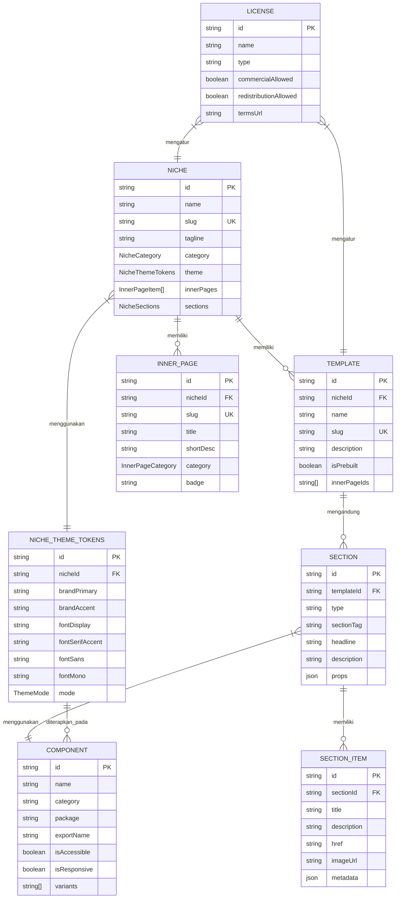

# ERD — Entity Relationship Diagram

## Hudbird UI Pro Monorepo (v1.5.0)

**Dokumen:** Entity Relationship Diagram  
**Produk:** Hudbird UI Pro — Complete Monorepo Ecosystem  
**Versi:** 1.5.0  
**Status:** Draft  
**Tanggal:** 2026-11-03  
**Pemilik Produk:** daniakbar / gpamdani-git

> **Catatan:** Hudbird UI Pro adalah perpustakaan komponen React/Tailwind (design system), bukan aplikasi SaaS dengan basis data transaksional. ERD di bawah adalah **model data konseptual/logis** dari sistem desain (Niche, Template, Section, Component, ThemeToken, InnerPage, dan License), yang direpresentasikan dalam skema TypeScript di `packages/schemas/src/types.ts` dan `packages/schemas/src/niches/`.

---

## 1. Diagram ER (Mermaid)



---

## 2. Deskripsi Entitas

| Entitas              | Deskripsi                                                                                                                                                                                                                                                              | Sumber                                                                                             |
| -------------------- | ---------------------------------------------------------------------------------------------------------------------------------------------------------------------------------------------------------------------------------------------------------------------- | -------------------------------------------------------------------------------------------------- |
| **Niche**            | Kategori industri template (AI SaaS, Fintech, Cybersecurity, Wellness, Agency, dll.). Memuat konfigurasi lengkap: navbar, hero, logos, services, case studies, process, pricing, FAQ/testimonials, footer, dan ekstensi spesifik niche (AI, fintech, cyber, wellness). | `packages/schemas/src/types.ts` → `NicheConfig`                                                    |
| **Template**         | Halaman utama yang dibangun dari satu niche. Berisi daftar section dan halaman inner yang terkait.                                                                                                                                                                     | `packages/schemas/src/niches/prebuilt-47.ts`                                                       |
| **Section**          | Bagian halaman (Hero, Pricing, Testimonial, FAQ, CTA, Footer, dll.). Setiap section memiliki props yang ditentukan oleh tipe TypeScript.                                                                                                                               | `packages/schemas/src/types.ts` → `HeroAgencyProps`, `PricingGridProps`, dll.                      |
| **Component**        | UI primitive (Button, Card, Dialog, Dropdown, Form, Navbar, Sheet, Tabs, Tooltip, dll.). Setiap komponen diekspor dari `@hudbird/ui` dan memiliki varian, dukungan aksesibilitas, dan responsivitas.                                                                   | `packages/core/src/components/*`                                                                   |
| **SectionItem**      | Item individual dalam section (misalnya: item testimonial, item pricing tier, item case study, item service).                                                                                                                                                          | `packages/schemas/src/types.ts` → `TestimonialItem`, `PricingTier`, `CaseStudyItem`, `ServiceItem` |
| **NicheThemeTokens** | Design tokens per niche: warna utama, warna aksen, font display, font serif, font sans, font mono, dan mode tema (light/dark).                                                                                                                                         | `packages/schemas/src/types.ts` → `NicheThemeTokens`                                               |
| **InnerPage**        | Halaman tambahan per niche (Case Studies, Blog, Careers, Pricing Matrix, Client Workspace, Sprint Estimator, Legal, Auth, dll.).                                                                                                                                       | `packages/schemas/src/niches/inner-pages.ts`                                                       |
| **License**          | Lisensi komersial yang mengatur hak penggunaan niche dan template (boleh komersial, tidak boleh redistribusi sumber sebagai produk bersaing).                                                                                                                          | `LICENSE.md`                                                                                       |

---

## 3. Kardinalitas Relasi

| Relasi                       | Kardinalitas | Keterangan                                                                                        |
| ---------------------------- | ------------ | ------------------------------------------------------------------------------------------------- |
| Niche → Template             | 1 : N        | Satu niche memiliki banyak template (47+ prebuilt template).                                      |
| Niche → InnerPage            | 1 : N        | Satu niche memiliki banyak halaman inner (standar 24 halaman inner).                              |
| Niche → NicheThemeTokens     | 1 : 1        | Satu niche menggunakan satu set design tokens.                                                    |
| Template → Section           | 1 : N        | Satu template mengandung banyak section.                                                          |
| Section → Component          | N : 1        | Banyak section menggunakan satu jenis komponen (misalnya banyak section menggunakan Button).      |
| Section → SectionItem        | 1 : N        | Satu section memiliki banyak item (misalnya section Testimonial memiliki banyak TestimonialItem). |
| NicheThemeTokens → Component | 1 : N        | Design tokens diterapkan pada banyak komponen.                                                    |
| License → Niche              | N : 1        | Satu lisensi mengatur banyak niche.                                                               |
| License → Template           | N : 1        | Satu lisensi mengatur banyak template.                                                            |

---

## 4. Contoh Instance Data (Conseptual)

```json
{
  "niche": {
    "id": "niche-ai-copilot",
    "name": "AI Copilot",
    "slug": "ai-copilot",
    "category": "ai-saas",
    "theme": {
      "brandPrimary": "#6366f1",
      "brandAccent": "#a855f7",
      "fontDisplay": "Inter",
      "fontSans": "Inter",
      "mode": "dark-default"
    }
  },
  "template": {
    "id": "tpl-ai-saas-landing",
    "nicheId": "niche-ai-copilot",
    "name": "AI SaaS Landing",
    "slug": "ai-saas-landing",
    "isPrebuilt": true
  },
  "section": {
    "id": "sec-hero-ai",
    "templateId": "tpl-ai-saas-landing",
    "type": "hero",
    "headline": "Build AI agents that ship",
    "componentId": "comp-hero"
  },
  "component": {
    "id": "comp-hero",
    "name": "Hero",
    "package": "@hudbird/marketing",
    "isAccessible": true,
    "isResponsive": true
  },
  "license": {
    "id": "lic-hudbird-pro",
    "name": "Hudbird UI Pro Commercial License",
    "commercialAllowed": true,
    "redistributionAllowed": false
  }
}
```

---

## 5. Mapping ke Kode Sumber

| Entitas                   | File / Path                         | Tipe / Export                     |
| ------------------------- | ----------------------------------- | --------------------------------- |
| Niche                     | `packages/schemas/src/types.ts:418` | `NicheConfig`                     |
| NicheThemeTokens          | `packages/schemas/src/types.ts:5`   | `NicheThemeTokens`                |
| Section (Hero)            | `packages/schemas/src/types.ts:54`  | `HeroAgencyProps`                 |
| Section (Pricing)         | `packages/schemas/src/types.ts:182` | `PricingGridProps`                |
| SectionItem (Testimonial) | `packages/schemas/src/types.ts:195` | `TestimonialItem`                 |
| InnerPage                 | `packages/schemas/src/types.ts:17`  | `InnerPageItem`                   |
| Component                 | `packages/core/src/index.ts`        | `export * from "./components/*"`  |
| License                   | `LICENSE.md`                        | Hudbird UI Pro Commercial License |

---

## 6. Asumsi & Keterbatasan

- Model ini bersifat konseptual untuk sistem desain, bukan skema basis data produksi.
- Tidak ada entitas User, Order, Payment, atau Session karena produk ini adalah perpustakaan komponen, bukan platform transaksional.
- Relasi Section → Component adalah asosial logical (section menggunakan komponen), bukan foreign key fisik.
- Semua data disimpan sebagai konfigurasi TypeScript, tidak dalam basis data relasional.

---

**Dokumen ini merupakan bagian dari dokumentasi internal Hudbird UI Pro. Untuk pertanyaan, hubungi support@hudbird.studio atau daniakbar.**

## Branded composition model (additive pilot)

`BrandProfile` scopes visual tokens and logo/reference metadata. `PageComposition` selects one `HeroSectionConfig` and an ordered list of section IDs. `StartupPageContent` holds shared page content, including `HeroContent`, independently of layout. Replacing a hero config therefore retains brand and shared content. These are TypeScript configuration objects in `packages/schemas/src/composition.ts`, not database tables or a change to the existing NicheConfig.

## SaaS landing collection model

`LandingPageConfig` version 1 combines one `BrandProfile`, an auto/light/dark preference, and an ordered array of 12 `LandingSectionSelection` objects. Each selection contains a section type, its allowed layout variant, and visibility. Navbar/footer positions are fixed; content sections may reorder. `LandingVariantMap` constrains variants by type, while `LandingSectionContent` holds shared content independently. The same configuration powers the live preview and React/JSON exports. Persistence is browser localStorage, with validation on restore; no server database is introduced. See `docs/HUDBIRD-LANDING-SECTIONS.md`.
