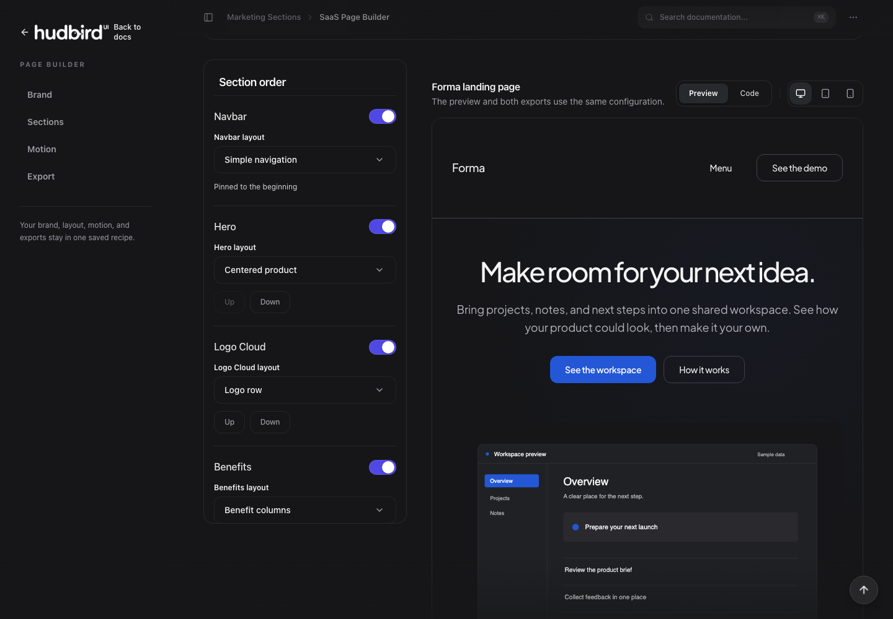

# 🦅 Hudbird UI Pro — Complete Monorepo Ecosystem

<p align="left">
  <a href="https://www.npmjs.com/package/hudbird-ui"></a>
  <a href="https://discord.gg/NPBspwkXke"></a>
  <a href="https://github.com/gpamdani-git/Hudbird"></a>
  <a href="https://hudbird.vercel.app"></a>
  
</p>

> **The modern, motion-first React & Tailwind component ecosystem.**  
> Complete with 123+ UI primitives, signature blocks, 8 complete niche templates, interactive page builder, CLI generator, and live documentation.

Welcome to the **Hudbird UI Pro Monorepo** (v1.6.0). This package contains the entire production source code, tooling, and templates powering the Hudbird ecosystem.

---

## 🎨 Interactive Page Builder

Build, customize, and export production-ready landing pages and SaaS templates directly inside the browser with zero external dependencies.

<div align="center">
  <picture>
    <source media="(prefers-color-scheme: dark)" srcset="./public/assets/homepage/builder-sections-dark.png">
    <source media="(prefers-color-scheme: light)" srcset="./public/assets/homepage/builder-sections-light.png">
    
  </picture>
  <p align="center"><sub><i>Live Page Builder: Real-time section ordering, 27 responsive layout archetypes, brand theme customizer, and one-click code/recipe export.</i></sub></p>
</div>

### ✨ What You Can Do in the Page Builder:

- **12 Typed SaaS Sections & 27 Layouts**: Navbar, Split & Editorial Hero, Logo Cloud Marquee, Benefits Columns, Feature Showcase, How It Works, Integrations Grid, Testimonials (with Video Stories), Pricing Comparison, FAQ, CTA, and Footer.
- **Brand Palette & Theme Inspector**: Real-time OKLCH primary/accent switcher with automatic contrast ratio verification (WCAG AA/AAA Pass).
- **Cinematic FullscreenVideoPlayer**: Embedded UHD collaborative story player with backdrop blur, rounded bezel, and subtitle overlay.
- **Export Anywhere**: Copy complete React + Tailwind TSX code, download recipe JSON, or scaffold directly via the CLI.

---

## ⚡ Quick Start: Add Components via CLI

You can install any component, signature block, or complete template directly into your existing React / Next.js / Vite project using `hudbird-ui` (v1.6.0):

```bash
# Initialize your project configuration (components.json)
npx hudbird-ui@latest init

# List all 123 available components, sections, and templates
npx hudbird-ui@latest list

# Install UI Primitives & Motion Blocks
npx hudbird-ui@latest add button card dialog kinetic-button sticky-stack

# Install Signature Blocks
npx hudbird-ui@latest add morphing-island agent-artifact-canvas interactive-bento

# Install Complete Niche Industry Templates
npx hudbird-ui@latest add template-saas
npx hudbird-ui@latest add template-ai
npx hudbird-ui@latest add template-fintech
npx hudbird-ui@latest add template-agency
```

---

## 📂 Monorepo Architecture Overview

This repository is organized as a high-performance **PNPM & Turborepo workspace**:

```text
Hudbird (Root)
├── apps/
│   └── docs/                     # Full Documentation SPA & Interactive Component Playground (Vite + React)
├── packages/
│   ├── core/                     # @hudbird/ui: 70+ Featherweight UI Primitives (CVA + Framer Motion)
│   ├── marketing/                # @hudbird/marketing: 12 SaaS landing sections, signature blocks, & video player
│   ├── theme/                    # @hudbird/theme: Color tokens, CSS variables, & dynamic palette generators
│   ├── schemas/                  # @hudbird/schemas: Type definitions, composition models & data schemas
│   └── cli/                      # hudbird-ui: Modern interactive CLI for scaffolding 123 components & templates
├── starter-kits/
│   └── pro-templates/            # Production Nexus showcase featuring 47 niche demos & complete inner pages
├── .agents/                      # AI design skills, craft workflows, and prompt engineering rules
├── pnpm-workspace.yaml           # Multi-package linking config
└── turbo.json                    # Turborepo build & caching pipelines
```

---

## ⚡ Prerequisites

Before running the monorepo, ensure you have the following installed on your machine:

1. **Node.js**: `v20.x` or higher (LTS recommended)
   ```bash
   node -v
   ```
2. **PNPM**: `v9.x` or higher (Required for workspace resolution)
   If you don't have PNPM installed yet, enable it instantly with Corepack or NPM:
   ```bash
   corepack enable pnpm
   # or: npm install -g pnpm
   ```

---

## 🚀 Local Development Setup

### Step 1: Install Dependencies

From the monorepo root directory, install all workspace packages:

```bash
pnpm install
```

### Step 2: Build All Core Packages

Build internal packages (`@hudbird/ui`, `@hudbird/marketing`, `@hudbird/schemas`, `@hudbird/theme`, `hudbird-ui`):

```bash
pnpm build:packages
```

### Step 3: Launch Local Development Servers

You can run either the documentation portal or the Nexus templates showcase (or both simultaneously):

#### Option A: Run the Documentation & Interactive Page Builder (Port 3000)

```bash
pnpm dev
```

Open **[http://localhost:3000](http://localhost:3000)** in your browser to view:

- **Interactive Page Builder**: `http://localhost:3000/#/marketing/landing-builder`
- **Component Playgrounds**: Live editable code previews for all 123 primitives & sections
- **Theme Studio**: Dynamic OKLCH color token & typography generator

#### Option B: Run the Nexus Pro Templates Showcase (Port 5173)

```bash
pnpm dev:starter
```

Open **[http://localhost:5173](http://localhost:5173)** in your browser to explore:

- **47 Prebuilt Niche Demos**: AI Copilot, Cyber Shield, Fintech Protocol, Digital Agency, Alunara Wellness, SaaS, Hospitality, E-Commerce, etc.
- **14 Inner Pages**: Case Studies, Blog & Post Detail, Careers, Pricing Matrix, Client Workspace, Sprint Estimator, Legal, Auth, etc.
- **Live Viewport Switcher**: Desktop, Tablet, and Mobile simulation toolbar.

---

## 📦 Workspace Packages Breakdown

### 1. `@hudbird/ui` (`packages/core`)

Featherweight, accessible primitives with zero runtime fluff.

- **Primitives & Layout**: Accordion, Alert, Avatar, Badge, Button, Calendar, Card, Checkbox, ComboBox, Command, Container, Dialog, Divider, DoubleBezelCard, Dropdown, EditorialImage, Fieldset, Form, GoldenGateGlass, Grid, Heading, HudbirdIcon, IconBox, InfiniteScroll, Input, InputOTP, KineticButton, LiquidGlass, Navbar, NavigationMenu, Pagination, Popover, Progress, RadioGroup, Section, Select, Sheet, Sidebar, Skeleton, Slider, Slot, SplitTextReveal, StickyStack, Switch, Table, Tabs, Text, Textarea, Toast, Tooltip.
- **Installation via CLI**:
  ```bash
  npx hudbird-ui add Button DoubleBezelCard KineticButton StickyStack
  ```

### 2. `@hudbird/marketing` (`packages/marketing`)

Aesthetic marketing sections, signature blocks, and media players.

- **Sections**: BentoGrid, BlueprintStudio, BlurRevealText, Cta, Faq, FeatureSection, Footer, Globe, HeroSection, LandingBenefits, LandingCta, LandingFaq, LandingFeatureShowcase, LandingFooter, LandingHowItWorks, LandingIntegrations, LandingLogoCloud, LandingNavbar, LandingPricing, LandingShared, LandingTestimonials, ParticleSphere, Pricing, Testimonials.
- **Signature Blocks**: `MorphingIsland`, `AgentArtifactCanvas`, `InteractiveBentoShowcase`.
- **Media**: `FullscreenVideoPlayer` (cinematic modal with backdrop-blur, rounded bezel, and subtitle overlay).
- **Installation via CLI**:
  ```bash
  npx hudbird-ui add morphing-island video-player hero-section
  ```

### 3. `@hudbird/schemas` (`packages/schemas`)

Complete TypeScript models, metadata, and composition schemas for all templates and builder layouts.

```tsx
import type { BrandProfile, LandingSectionProps, NavbarPresetId } from "@hudbird/schemas";
```

### 4. `@hudbird/theme` (`packages/theme`)

Tailwind CSS variable design tokens supporting seamless Light Mode, Sleek Dark Mode, and bespoke multi-palette branding.

### 5. `hudbird-ui` (`packages/cli`)

Interactive developer CLI tool to scaffold 123 components, sections, signature blocks, and complete niche templates with recursive subfolder support and smart alias resolution.

---

## 📜 Monorepo Scripts Reference

| Command               | Description                                                  |
| :-------------------- | :----------------------------------------------------------- |
| `pnpm install`        | Install all dependencies across all packages and apps        |
| `pnpm build`          | Turbo build: builds all packages, apps, and starter kits     |
| `pnpm build:packages` | Fast build: compiles all 5 packages in `packages/*`          |
| `pnpm dev`            | Starts the `apps/docs` documentation server (Port 3000)      |
| `pnpm dev:starter`    | Starts the `starter-kits/pro-templates` showcase (Port 5173) |
| `pnpm test`           | Runs the Vitest test suite (310/310 tests passing)           |
| `pnpm release`        | Builds packages and publishes updates to NPM with Changesets |
| `pnpm sync-changelog` | Synchronizes changelog to docs data                          |
| `pnpm lint`           | Runs ESLint across the entire monorepo                       |
| `pnpm format:fix`     | Runs Prettier to auto-format all code                        |

---

## 🤖 AI Agent Skills (Claude Code, Codex, Antigravity, Cursor, Windsurf)

Hudbird UI includes an official AI engineering skill that enables coding models to build interfaces without hallucinating non-existent props or CSS soup:

```bash
# Install the AI skill into any project in 1 line
mkdir -p .agents/skills/hudbird-ui && curl -sSL https://raw.githubusercontent.com/gpamdani-git/Hudbird/main/.agents/skills/hudbird-ui/SKILL.md -o .agents/skills/hudbird-ui/SKILL.md
```

- **Supported assistants**: Anthropic Claude Code, Google Antigravity, Cursor IDE, Windsurf Cascade, and OpenAI Codex.
- **Official Documentation**: [https://hudbird.vercel.app/#/ai-skills](https://hudbird.vercel.app/#/ai-skills)

---

## 📄 License & Commercial Rights

This product is licensed under the **Hudbird UI Pro Commercial License** (`LICENSE.md`).

- ✅ **Allowed**: Unlimited commercial websites, SaaS apps, internal tools, and client deliverables.
- ❌ **Prohibited**: Reselling, public re-distribution, or sharing raw monorepo source code as a competing template/library product.

---

## 💬 Community, Support & Links

- **Documentation**: [https://hudbird.vercel.app](https://hudbird.vercel.app)
- **Interactive Page Builder**: [https://hudbird.vercel.app/#/marketing/landing-builder](https://hudbird.vercel.app/#/marketing/landing-builder)
- **NPM Package**: [https://www.npmjs.com/package/hudbird-ui](https://www.npmjs.com/package/hudbird-ui)
- **GitHub Repository**: [https://github.com/gpamdani-git/Hudbird](https://github.com/gpamdani-git/Hudbird)
- **Report an Issue**: [https://github.com/gpamdani-git/Hudbird/issues](https://github.com/gpamdani-git/Hudbird/issues)
