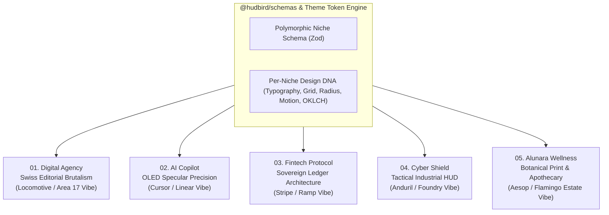

# Product Requirements Document (PRD) — V2.0 (Awwwards & UI8 Flagship Edition)

# Project: Hudbird Nexus — Polymorphic Multi-Niche Design System & Template Ecosystem

**Target Market:** UI8 Featured ($129–$299), Awwwards SOTD / Developer Award, Behance Featured (Interaction), Dribbble Popular, LemonSqueezy / Gumroad Pro Studios  
**Core Engine:** Polymorphic Multiplier Architecture (5 Distinct Flagship Visual Languages + 24 Domain-Adaptive Inner Views)  
**Foundational Stack:** React 19, TypeScript, Tailwind CSS v4 (OKLCH Token Engine), Motion (`motion/react`), `@hudbird/ui`, `@hudbird/schemas`  
**Execution Model:** Gemini 4 Argon (Section-by-Section Deep Craft) + AI Pro Weekly Quota Optimization

---

## 1. Forensic Design Audit: Why Nexus V1 Fell Into "AI Slop"

An audit of `starter-kits/pro-templates/src/components/nexus-sections/` revealed the exact root causes making the current UI feel AI-generated rather than human-art-directed:

### 1.1 The "Palette-Swap Clone" Fallacy (Structural Sameness)

In V1, `FintechNicheHome.tsx`, `CyberShieldNicheHome.tsx`, and `AlunaraWellnessNicheHome.tsx` share an **identical DOM skeleton**:

- **Identical Background Blur Blob:** Every hero renders the exact same `w-[700px] h-[450px] opacity-15 blur-[120px] rounded-full` centered radial gradient, merely swapping hex codes (`#F59E0B` vs `#6366F1` vs `#794A8B`).
- **Identical Centered Hero Stack:** Every niche uses `max-w-4xl mx-auto text-center`, a pill badge at the top, a headline with **one italic underlined word** (`decoration-wavy`), a centered `max-w-2xl` subheadline, and a centered `<DoubleBezelCard>` box below.
- **Identical Bolted-On Tail Sections:** Every niche blindly appends the exact same `<LogoMarquee />`, `<PricingGrid />`, `<FaqWithTestimonials />`, and `<SplitTextCtaFooter />` at the bottom—resulting in a Luxury Botanical Skincare brand (`Alunara Wellness`) displaying a B2B SaaS monthly/quarterly retainer table.

### 1.2 Mechanical "Template Chrome" Tells

Following our `frontend-design` and `bencium-innovative-ux-designer` protocols, V1 exhibits the 5 classic tells of LLM-generated pages:

1. **Single-Word Italic/Wavy Highlight:** Putting one word in `font-serif italic underline decoration-wavy` in every single `<h1>` across every industry.
2. **Universal Monospace Eyebrow Badges:** Forcing `[ 01 — EYEBROW LABEL ]` in `font-mono uppercase tracking-[0.22em]` onto non-technical subjects where monospace feels alien.
3. **Uniform Card Wrapping:** Chopping every feature into identical rounded cards with the same border radius and padding regardless of content hierarchy.
4. **Forced Structural Rails:** Applying `fixed inset-y-0 max-w-[1320px] border-x border-nx-line` in `SectionRenderer.tsx` globally across all niches, even when a niche calls for full-bleed editorial photography or asymmetric canvas freedom.
5. **Decorative Numbering on Non-Sequential Content:** Adding `01 / 02 / 03` badges to items that are not a chronological sequence.

---

## 2. The V2 Paradigm: "Zero-Clone Polymorphic Architecture"

To win **UI8 Featured** and **Awwwards SOTD**, Hudbird Nexus V2 transitions from a "Single Layout with Color Swaps" to **5 Genuinely Independent Art-Directed Systems** powered by a shared TypeScript/Zod schema backbone (`@hudbird/schemas`).

> **Core Law:** Each niche must look as if it were designed by a different world-class specialist studio (e.g., _Locomotive_ for Agency, _Linear/Cursor_ for AI, _Stripe/Chronicle_ for Fintech, _Anduril/Palantir_ for Cyber, _Aesop/Kinfolk_ for Wellness). **Zero shared hero skeletons. Zero shared card chrome across incompatible domains.**

---

## 3. Deep UI/UX Art Direction Per Niche (Awwwards / UI8 Spec)

### Niche 01: `digital-agency` — **KINETIC SWISS EDITORIAL**

- **Benchmark References:** _Locomotive_, _Area 17_, _Studio Freight_, _Bürocratik_
- **Aesthetic Posture:** Stark architectural authority, extreme typographic scale contrast, raw Swiss grid hairline rules (`0px` corner radius on structural cells), and tactile physical media.
- **Color System (High-Contrast Paper & Carbon):**
  - Light Mode (Default): Warm Newsprint Ground `#F4F2ED`, Stark Carbon Ink `#0E0E10`, International Klein Vermilion Accent `#E63B19`, Hairline Rule `#D8D4CC`.
  - Dark Mode: Pitch Obsidian `#0A0A0C`, Chalk Bone `#F2F0EA`, Vermilion Signal `#FF4422`, Hairline Rule `#1F1F24`.
- **Typography & Hierarchy:**
  - Display: `Syne` or `Plus Jakarta Sans` (`font-extrabold tracking-[-0.045em] leading-[0.88]`, scale up to `clamp(3.75rem, 9.5vw, 8.75rem)`).
  - Editorial Counterpoint: `Instrument Serif` or `Playfair Display` (used for full sentence pull-quotes and project classifications, **never** as a single wavy-underlined word inside a sans headline).
  - Technical Index: `JetBrains Mono` (`11px`, tabular numerals for archive years `2021—2026` and deliverable indices).
- **Signature Section Anatomy (6 Bespoke Sections):**
  1. **Asymmetric Manifesto & Showreel Hero:** Full-viewport 12-column Swiss poster layout. Top-left massive flush-left display statement; bottom-right interactive video/canvas showreel aperture that expands on scroll scrub.
  2. **Interactive Index Dossier (Services):** Full-width horizontal architectural table (`border-y border-nx-line`). Hovering a discipline row slides open a high-resolution project reel preview and expands scope deliverables inline with smooth height physics.
  3. **Selected Works Exhibition Grid:** Asymmetric 2-column staggered gallery (`col-span-7` paired with offset `col-span-5`). Uses `<EditorialImage />` with `contrast-[1.04] saturate-[0.88]`, project client metadata, year, and verified conversion delta.
  4. **5-Phase Sticky Architectural Stack:** Pinned scroll sequence where each methodology phase (`01 Audit` → `05 Hand-off`) locks into the viewport frame while previous phases compress into a visible stacked index header (`48px` tall).
  5. **Interactive Sprint & Retainer Configurator:** Replaces generic SaaS pricing cards with an agency engagement configurator (Select Project Scope, Pod Velocity, Add-on Disciplines → Live estimated timeline & investment output).
  6. **Monumental Split-Curtain Footer:** Full-bleed vermilion/carbon reveal footer with oversized interactive `"INITIATE DIALOGUE"` trigger and live studio timezone clocks (Tokyo, Zurich, New York).

---

### Niche 02: `ai-copilot` — **OLED SPECULAR SANDBOX**

- **Benchmark References:** _Cursor_, _Linear_, _Raycast_, _Zed_, _Vercel v0_
- **Aesthetic Posture:** Sub-millimeter dark-mode engineering, pitch-black OLED canvas, `1px` specular top-edge light refraction, keyboard-first ergonomics (`⌘K`, `⌘⏎`), and live executable code diffs.
- **Color System (OLED Dark Native):**
  - Canvas Ground: `#050608` (True OLED Black)
  - Elevated Surface: `#0B0D12` with `shadow-[inset_0_1px_0_0_rgba(255,255,255,0.09)]`
  - Primary Text: `#F3F5F8` | Secondary Muted: `#7E8694`
  - Specular Accent: Emerald Matrix `#10B981` (Verified Diffs) & Cyan Laser `#06B6D4` (Active Token Stream)
  - Border Hairline: `rgba(255, 255, 255, 0.07)`
- **Typography & Hierarchy:**
  - UI & Display: `Inter` (`font-semibold tracking-[-0.035em] leading-[1.05]`, crisp optical sizing).
  - Code & Telemetry: `JetBrains Mono` / `Fira Code` (ligatures enabled, syntax-highlighted AST tokens).
- **Signature Section Anatomy (6 Bespoke Sections):**
  1. **Split-Pane Live IDE Hero:** Left column: concise engineering value proposition + CLI install command (`npx hudbird-ai init`) with one-click copy + keyboard shortcut pills. Right column (spanning 7 cols): Multi-tab interactive AST Diff & Kernel Verification Sandbox with live token-stream replay, TTFT latency meter, and file tree switcher.
  2. **Frontier Benchmark Telemetry Strip:** Interactive horizontal comparison bar chart (`TTFT 12ms`, `194 tok/s`, `SWE-Bench Verified 78.4%`) with toggleable model comparisons and real-time latency jitter sparklines.
  3. **Code-Over-Stock Bento Architecture:** 4-cell asymmetric bento where **every cell is a working interactive micro-widget**:
     - _Cell A:_ Interactive Context Graph (clickable repo nodes showing token weight).
     - _Cell B:_ Zero-Retention Privacy Enclave toggle (live encryption hash preview).
     - _Cell C:_ Multi-File Speculative Edit scrubber.
     - _Cell D:_ Keyboard-First Command Palette simulator.
  4. **3-Stage Pipeline Execution Trace:** Interactive step-by-step trace (`01 AST Parse` → `02 Speculative Synthesis` → `03 Formal Symbolic Proof`) where clicking a stage updates an inspectable JSON/AST payload viewer.
  5. **Compute & Seat Allocation Matrix:** Token/seat slider calculator paired with Self-Hosted VPC vs Cloud Enclave comparison table.
  6. **Terminal Prompt Footer:** Minimalist CLI-inspired footer where users can type or click preset commands to jump to docs, changelog, or playground.

---

### Niche 03: `fintech-protocol` — **SOVEREIGN INSTITUTIONAL LEDGER**

- **Benchmark References:** _Stripe_, _Ramp_, _Bridge_, _Chronicle_, * Wise Platform*
- **Aesthetic Posture:** Institutional trust, Swiss banking precision, high-density financial data legibility, hair-thin isometric routing lines, and provable cryptographic reserve transparency.
- **Color System (Dual Institutional Light & Sovereign Dark):**
  - Light Mode (Institutional Default): Crisp Ledger Paper `#F8FAFC`, Deep Navy Ink `#090D16`, Sovereign Gold/Amber `#D97706`, Settlement Emerald `#059669`, Grid Border `#E2E8F0`.
  - Dark Mode (Trading Terminal): Midnight Vault `#040711`, Slate Surface `#0B1120`, Bullion Accent `#F59E0B`, Grid Border `#1E293B`.
- **Typography & Hierarchy:**
  - Display: `Plus Jakarta Sans` (`font-semibold tracking-[-0.03em]`, authoritative, zero decorative gimmicks).
  - Financial Ledger & Tickers: `JetBrains Mono` with mandatory `tabular-nums` on every currency figure, basis point (`bps`), APY percentage, and settlement timestamp.
- **Signature Section Anatomy (6 Bespoke Sections):**
  1. **Architectural Treasury & Live Liquidity Router Hero:** Left-aligned institutional headline paired with an **Interactive Cross-Border Settlement & Yield Simulator** (input principal amount `$1M–$500M`, select corridor `USD → EUR / SGD / GBP / USDC`, inspect live atomic route, fee breakdown in `bps`, and T+0 settlement proof).
  2. **Real-Time Proof-of-Reserve & Custodian Ledger:** Live tabular audit matrix showing custodian distribution (BNY Mellon, Fireblocks, Anchorage), collateralization ratio (`104.2%`), and verifiable Merkle root hash inspector.
  3. **Programmable Treasury Bento:** 3-column architectural grid featuring a working **Automated Sweep Rule Builder** (`IF Operating Account > $2.5M → Sweep to T-Bills @ 5.18%`), multi-sig approval flow diagram, and ERP reconciliation feed.
  4. **Global Corridor Latency Matrix:** Interactive regional table comparing Nexus Atomic Settlement (`420ms`) vs Legacy SWIFT (`2–5 Days`) across 14 G20 currencies.
  5. **Volume-Tiered Institutional Fee Schedule:** Transparent basis-point (`bps`) volume calculator rather than generic SaaS $29/$99 cards.
  6. **Regulatory & Compliance Footer:** Full SOC2 Type II, ISO 27001, MiCA, and FinCEN disclosure matrix with institutional onboarding CTA.

---

### Niche 04: `cyber-shield` — **TACTICAL INDUSTRIAL COMMAND HUD**

- **Benchmark References:** _Anduril Lattice_, _Palantir Foundry_, _CrowdStrike Falcon_, _grafanacon_
- **Aesthetic Posture:** Zero-radius (`rounded-none`) industrial hardware precision, tactical telemetry overlays, coordinate crosshairs (`+`), high-density monospace readouts, and autonomous defense posture.
- **Color System (Tactical Carbon & Phosphor Signal):**
  - Ground: Bunker Carbon `#060807` | Panel Surface: `#0C100E`
  - Primary Readout: `#E4ECE8` | Tactical Muted: `#687870`
  - Active Intercept Signal: Phosphor Radar Green `#00E676`
  - Critical Threat Vector: Amber Alert `#FFB300` & Crimson Breach `#FF2E4C`
  - Structural Frame: `1px solid #1A2420` (Sharp `0px` corners with `8px` corner bracket ticks)
- **Typography & Hierarchy:**
  - Tactical Display: `Space Grotesk` (`uppercase tracking-[-0.02em] font-bold`).
  - Telemetry & Logs: `Share Tech Mono` / `JetBrains Mono` (`tabular-nums`, strict column alignment).
- **Signature Section Anatomy (6 Bespoke Sections):**
  1. **Command Center HUD Hero:** Asymmetric split tactical console. Left: Mission-critical threat defense briefing + deployment status. Right: **Interactive eBPF Kernel Kill-Chain Radar & Packet Inspector**—users can click simulated attack vectors (`CVE-2026-4019 Lateral Movement`, `Ring-0 Privilege Escalation`, `DNS Exfiltration`) to watch the HUD isolate the node and generate an eBPF quarantine rule in real time.
  2. **Live Global Telemetry Ticker:** Pauseable, accessible real-time operational ribbon (`MTTD: 14ms`, `MTTQ: 380ms`, `Active Kernel Probes: 1.42M`, `False Positive Rate: 0.0003%`).
  3. **Defense-in-Depth Architecture Matrix:** 4-layer interactive stack (`L0 Hardware Enclave` → `L1 Linux eBPF Kernel` → `L2 Mesh Micro-Segmentation` → `L3 Autonomous SOC Response`) with expandable syscall telemetry.
  4. **Compliance & Air-Gapped Readiness Dossier:** Interactive selector for `FedRAMP High`, `DOD IL6`, `SOC2 Type II`, and `HIPAA` mapping exact cryptographic controls.
  5. **Cluster Node Sizing & Deployment Calculator:** Node/cluster estimator with Bare-Metal, Kubernetes, and Air-Gapped On-Premises licensing tiers.
  6. **Classified-Style Tactical Footer:** Coordinate grid footer with PGP security key fingerprint, incident response hotline, and zero-trust architecture whitepaper download.

---

### Niche 05: `alunara-wellness` — **BOTANICAL EDITORIAL & APOTHECARY**

- **Benchmark References:** _Aesop_, _Flamingo Estate_, _Kinfolk_, _Seed_, _Aman Essentials_
- **Aesthetic Posture:** Warm tactile paper, literary typography, generous breathing room (low density, expansive negative space), botanical formulation dossiers, and zero tech/SaaS clichés. **NO dark neon gradients, NO monospace developer badges, NO SaaS pricing tables.**
- **Color System (Warm Alabaster, Olive & Terracotta Earth):**
  - Light Mode (Mandatory Primary Experience): Unbleached Linen `#F6F3EC`, Warm Parchment Card `#EFECE4`, Deep Espresso Ink `#1C1915`, Botanical Umber Muted `#655E54`, Sage Leaf `#3D5245`, Terracotta Clay `#A85438`, Fine Rule `#DFD9CE`.
  - Evening Mode (Warm Candlelight, not cold tech dark): Deep Roasted Fig `#161311`, Warm Clay Text `#EAE3D5`, Amber Resin `#C88A5B`.
- **Typography & Hierarchy:**
  - Primary Literary Voice: `Cormorant Garamond`, `Lora`, or `Instrument Serif` (`font-normal tracking-[-0.015em] leading-[1.12]`, used for primary headlines and editorial storytelling).
  - Apothecary Specification: `Plus Jakarta Sans` or `Raleway` (`text-[13px] tracking-[0.04em]`, clean humanist sans for ingredient origins, dosage, and clinical trials).
- **Signature Section Anatomy (6 Bespoke Sections):**
  1. **Magazine Spread & Apothecary Dossier Hero:** Asymmetric 12-column editorial spread (`col-span-5` literary narrative + botanical origin notes on left; `col-span-7` curated still-life vessel showcase with interactive **Formulation Batch Apothecary Label** detailing harvest altitude, cold-press extraction temperature, and bioactive compounds).
  2. **Interactive Circadian Chronobiology Wheel:** A tactile 4-phase daily ritual selector (`06:00 Dawn Cortisol Calibration` → `13:00 Cognitive Meridian` → `19:00 Parasympathetic Unwind` → `22:30 Deep REM Cellular Repair`) that smoothly transitions the ambient canvas tone and reveals clinical biomarker outcomes.
  3. **Provenance & Wild-Harvest Atlas:** Editorial horizontal scroll / split dossier mapping raw botanical ingredients (e.g., _Adaptogenic Rhodiola — Altai Mountains, 2,400m_, _Ceremonial Hinoki — Kiso Valley_) with clinical bioavailability data.
  4. **Clinical Efficacy & Peer-Reviewed Study Accordion:** Clean, literary presentation of double-blind placebo-controlled trial metrics (`+42% HRV Recovery`, `-31% Evening Cortisol`) styled like an apothecary monograph.
  5. **Bespoke Ritual Curations (Replaces SaaS PricingGrid):** Apothecary product & membership curation showcase (_The Complete Circadian Quartet_, _Seasonal Refill Subscription_, _Private Sanctuary Consultation_) with vessel volume (`100mL / 3.4 fl. oz.`), refill cadence, and direct bag integration.
  6. **Quiet Literary Colophon Footer:** Inspired by fine book printing and _Aesop_ stores—featuring botanical journal signup, acoustic sanctuary playlists, B-Corp sustainability ledger, and physical atelier addresses (Kyoto, Copenhagen, Big Sur).

---

## 4. The Master Marketplace Sales Hub (`ShowcaseIndex.tsx`)

To convert buyers on **UI8, Gumroad, and LemonSqueezy**, the root `ShowcaseIndex.tsx` acts as the high-converting sales landing page:

1. **Above-the-Fold Polymorphic Switcher Hero:**
   - Allows prospective buyers to toggle between all **5 Flagship Niches** live inside an interactive viewport frame right in the hero, proving immediately that Nexus is 5 distinct art-directed systems—not 1 template with 5 colors.
2. **Interactive "Anti-AI Slop" Side-by-Side Comparison Slider:**
   - A draggable before/after or toggleable comparison showing "Generic AI Template (Flat Card)" vs "Hudbird Nexus Craft (Double-Bezel / Domain-Native Micro-UI)".
3. **Filterable 24-Inner-Page Architectural Matrix:**
   - Buyers can filter all 24 inner page archetypes (`Case Study Detail`, `Interactive Sprint Estimator`, `Client Portal`, `Apothecary Monograph`, `Legal Dossier`) with instant Light/Dark deep-link previews.
4. **Multiplier Schema Inspector:**
   - Shows developers how editing a single strongly-typed Zod `NicheConfig` file updates routes, tokens, and components with zero runtime overhead.

---

## 5. Gemini 4 Argon Execution Strategy & Weekly Sprint Roadmap

Because **Gemini 4 Argon** on AI Pro operates with a **weekly quota reset**, our execution is engineered around **High-Leverage Section-by-Section Prompts**.

### 5.1 Golden Rules for Argon 4 Quota Conservation

1. **1 Prompt = 1 Complete, Self-Contained Section or Niche Surface:** Never ask Argon to "update everything". Target 1 specific file or 1 specific niche homepage per turn.
2. **Zero Blind Generation:** Every prompt automatically follows the exact Typography, Palette, Grid, and Anti-Pattern constraints defined in Section 3 of this PRD.
3. **Pre-Flight Self-Validation (`opus-5-5-reasoning`):** Validate JSX tags, TypeScript interfaces, and Tailwind classes before writing so zero quota is burned fixing compile errors.

### 5.2 The 6-Phase Professional Sprint Plan

|    Sprint    | Focus Area                                            | Target Files                                                                                                          | Est. Argon Prompts | Deliverable Standard                                                                                                              |
| :----------: | :---------------------------------------------------- | :-------------------------------------------------------------------------------------------------------------------- | :----------------: | :-------------------------------------------------------------------------------------------------------------------------------- |
| **Sprint 1** | **Design Token Engine & Anti-Clone Shell**            | `SectionRenderer.tsx`, `index.css`, `@hudbird/schemas`                                                                |    2–3 Prompts     | Per-niche font pairings, OKLCH palettes, removal of global forced rail lines & clone wrappers.                                    |
| **Sprint 2** | **Niche 01: Digital Agency (Swiss Editorial SOTD)**   | `HeroAgency.tsx`, `ServicesInteractive.tsx`, `CaseStudyShowcase.tsx`, `StickyProcessSteps.tsx`, `AgencyNicheHome.tsx` |    4–5 Prompts     | Asymmetric Swiss grid, interactive project dossier, sprint configurator, monumental footer.                                       |
| **Sprint 3** | **Niche 05: Alunara Wellness (Botanical Apothecary)** | `AlunaraWellnessNicheHome.tsx` + dedicated apothecary sections                                                        |    3–4 Prompts     | Complete elimination of SaaS clone layout; warm linen palette, literary serif typography, circadian wheel, ritual curation cards. |
| **Sprint 4** | **Niche 03 (Fintech Ledger) & Niche 04 (Cyber HUD)**  | `FintechNicheHome.tsx`, `CyberShieldNicheHome.tsx`                                                                    |    4–5 Prompts     | Institutional liquidity router + Proof-of-Reserve table for Fintech; zero-radius eBPF tactical radar HUD for Cyber.               |
| **Sprint 5** | **Niche 02: AI Copilot (OLED Sandbox Perfection)**    | `AICopilotNicheHome.tsx`, `HeroAICopilot.tsx`, `AICapabilitiesBento.tsx`                                              |    3–4 Prompts     | True OLED `#050608` specular precision, interactive AST diff sandbox, keyboard-first micro-UIs.                                   |
| **Sprint 6** | **Master UI8 Sales Hub & 24 Inner Pages Polish**      | `ShowcaseIndex.tsx`, `NexusInnerPageRenderer.tsx`                                                                     |    3–4 Prompts     | Interactive 5-niche switcher hero, before/after craft comparator, marketplace packaging.                                          |

**Total Estimated Argon Consumption Across Full Overhaul:** ~19–25 focused prompts (easily fits within **1 to 1.5 weekly AI Pro cycles** with zero wasted tokens).

---

## 6. Mandatory Pre-Delivery Quality Gate (Per Section)

Before any section in Sprints 1–6 is marked complete, it must pass all 8 checks from `ui-ux-pro-max` and `frontend-design`:

- [ ] **Independence Test:** Could you swap the brand name and colors with another niche and have it look the same? If YES → **REJECT & REBUILD**.
- [ ] **Zero Wavy-Underline Italic Cliché:** No single-word `underline decoration-wavy` inside centered headlines.
- [ ] **Domain-Native Interactive Artifact:** Hero or primary section contains a working, stateful React micro-application specific to the industry (not static stock images or generic 3-box cards).
- [ ] **Typographic Discipline:** Line length `< 75ch` for body copy, `tabular-nums` on all numeric/financial/telemetry data, genuine optical contrast between display and body fonts.
- [ ] **Accessible Contrast & Focus:** Minimum `4.5:1` text contrast in both Light and Dark modes; visible `:focus-visible` rings; `prefers-reduced-motion` respected.
- [ ] **Zero Unprotected Icons:** Every icon serves a functional/informational purpose or lives inside a domain-appropriate housing.
- [ ] **Responsive Breakpoint Integrity:** Verified layout flow at `375px` (Mobile), `768px` (Tablet), `1024px` (Laptop), and `1440px+` (Desktop Studio).
- [ ] **Zero TypeScript / Build Errors:** Clean compilation across `starter-kits/pro-templates` and `@hudbird/schemas`.
